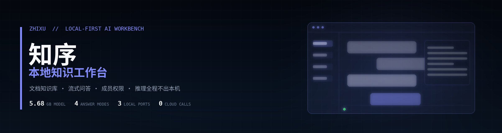
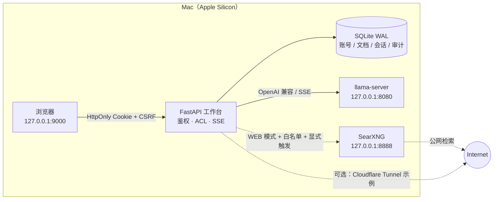
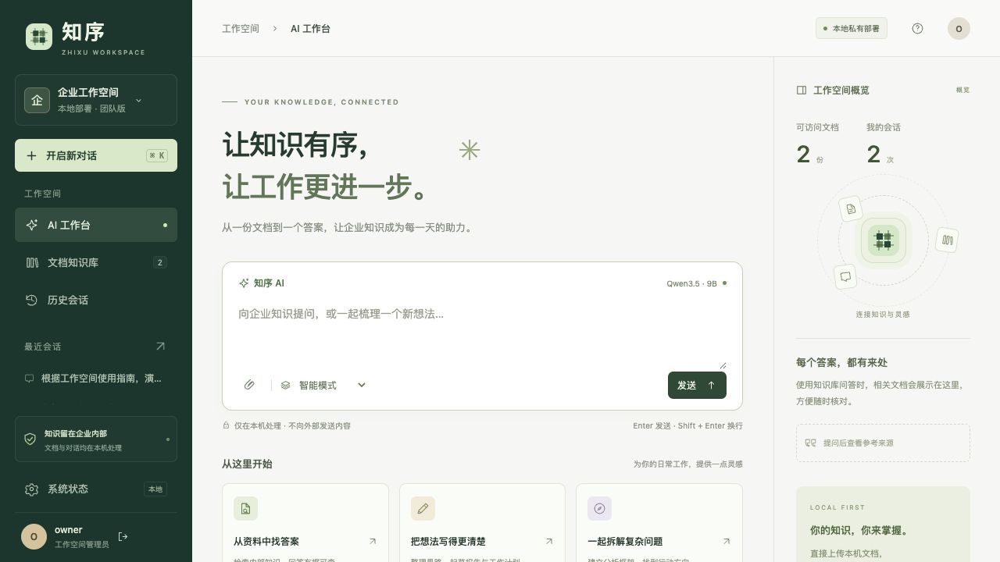

<p align="center">
  
</p>

<p align="center">
  
  
  
  
  
  
  
</p>

<p align="center">
  <strong>本地优先 · 数据不离机 · 权限到文档</strong><br>
  <sub>文档知识库 · 流式问答 · 历史会话 · 显式联网 · 成员与组级 ACL · 自动备份</sub>
</p>

---

| 本地模型 | 回答模式 | 本地端口 | 云端调用 |
| :---: | :---: | :---: | :---: |
| **5.68 GB** | **4 种** | **3 个** | **0 次** |

## 项目简介

企业知识通常散落在个人电脑和聊天记录里。接入公有云模型意味着把资料交出；完全不联网又无法回答“最近发生了什么”。

「知序」把两者拆开：

- **推理与资料留在本机**：Qwen3.5-9B（Q4_K_M，SHA256 锁定）经 llama.cpp Metal 在 Mac 上运行，文档、会话、审计保存在本机 SQLite。
- **权限先于检索**：文档按私有 / 组 / 全体可见分层，检索、引用、下载都过同一套 ACL；管理员不绕过他人私有文档。
- **联网是可审计的例外**：只有「服务端开关 + 账号白名单 + 用户显式触发」三个条件同时满足，才把**当前公开问题**发往搜索服务，不带历史与知识库。

一句话：把 ChatGPT 式的工作台装进一台 Mac——**问题、文档、会话、审计记录都不出机器**。当前为企业试点版本（v0.3.1），单机部署、默认只监听回环，边界见 [部署边界](#部署边界与已知限制)。

## 功能

| 模块 | 说明 |
| --- | --- |
| **AI 工作台** | 流式问答；AUTO / LOCAL / KNOWLEDGE / WEB 四种模式；可停止、复制、预览引用 |
| **文档知识库** | PDF / DOCX / Markdown / TXT / 常见代码上传；解析进程隔离；BM25 检索与引用溯源 |
| **历史会话** | 自动保存、恢复继续提问、导出 Markdown、来源权限二次过滤 |
| **联网搜索** | 本机 SearXNG + DNS 固定 + 重定向检查；只发送显式公开查询 |
| **成员与权限** | 多账号、admin / member、组级 ACL；网页成员管理；密钥轮换即时失效 |
| **自动备份** | LaunchAgent 每日快照，SHA256 校验，7 天 / 28 天两档保留策略 |
| **Token 预算** | 生成前用真实 tokenizer 计数；超限提示缩短或新开会话，不静默截断 |
| **系统状态** | 模型就绪、请求队列、审计事件、备份状态一屏呈现 |

## 架构



| 端口 | 服务 | 暴露范围 |
| :---: | --- | --- |
| `9000` | 工作台（FastAPI + 静态资源） | 仅 `127.0.0.1` |
| `8080` | 推理（llama-server） | 仅 `127.0.0.1` |
| `8888` | 检索（SearXNG / Waitress） | 仅 `127.0.0.1` |

### 数据模型

| 表 | 内容 |
| --- | --- |
| `users` · `api_keys` | 账号、角色、组、密钥（可轮换、可停用） |
| `documents` · `document_files` | 文档元数据、权限、原件 |
| `chunks` | 检索片段（BM25 索引单位） |
| `conversations` | 会话与消息、版本冲突检测 |
| `web_sources` · `web_sessions` | 网页来源快照、联网会话 |
| `audit_events` | 登录、上传、权限变更、检索等事件 |
| `ingest_runs` · `ingest_errors` | 目录入库批次与失败记录 |

## 快速开始

**前置条件**：macOS + Apple Silicon、[uv](https://docs.astral.sh/uv/)、Python 3.12–3.14、`llama-server`（llama.cpp）。

```bash
# 1. 安装依赖
uv sync --locked

# 2. 下载模型（约 5.68 GB，锁定 revision + SHA256）
python3 scripts/download_model.py

# 3. 启动推理服务
python3 scripts/start_model.py --binary /absolute/path/to/llama-server
```

另开终端，**仅首次**初始化账号：

```bash
uv run python -m local_ai create-user owner --role admin --key-file data/owner.key
uv run python -m local_ai ingest --owner owner --visibility public
```

启动工作台：

```bash
uv run python -m local_ai serve
```

打开 [http://127.0.0.1:9000/](http://127.0.0.1:9000/)，输入 `data/owner.key` 中的密钥登录。

> **已有本机工作区**：直接双击 `启动知序.command`，自动检查模型与搜索服务并打开浏览器。首次安装须在 `config/launcher.local.json` 中设置 `model_binary`。

```sh
./启动知序.command
.venv/bin/python scripts/start_workspace.py --status
```

## 工作台使用

<p align="center">
  
</p>

1. 在「文档知识库」上传文件（默认仅自己可见），可预览片段、下载原件、调整共享范围或删除。
2. 在「AI 工作台」选择回答模式提问；回答逐步显示，可停止、复制、点引用核对原文。
3. 完整回答自动保存到历史会话，可恢复继续提问或导出 Markdown。
4. 「系统状态」显示模型就绪、请求队列、审计事件与备份状态。

**文件限制**：单文件 5 MB、每账号 200 份 / 100 MB、PDF 150 页、正文 40 万字符；单次最多 10 个文件。加密 PDF 不支持。

## 知识库与检索

- 支持 PDF（可提取文字）、DOCX 普通表格与段落、Markdown、TXT 与常见代码文件。
- 当前检索为**中文字符 / 双字 + 英文标识符的 BM25 基线**，不是语义混合检索。
- 引用列表展示“提供给模型的证据”，不保证每条都被最终答案采用。
- 权限在检索、引用、下载三处同时生效；撤销后历史会话中的来源同步过滤。

## 联网搜索

只有三个条件同时满足才发起请求：服务端 `allow_web_search`、账号在 `allowed_users` 白名单、用户在当前问题显式选择「联网搜索」。发送内容是当前公开问题，不含历史与知识库资料。

```sh
python3 scripts/start_search.py          # 启动本机 SearXNG
python3 scripts/install_search.py        # 新环境首次安装搜索依赖
```

```toml
[policy]
allow_web_search = true
allow_cloud_inference = false
allow_private_context_export = false

[web]
searxng_url = "http://127.0.0.1:8888"
allowed_users = ["owner"]
```

> 联网搜索词不是保密通道，请勿填入机密内容。

<details>
<summary><b>联网检索迭代记录（2026-09-27 / 09-29）</b></summary>

- **检索与补搜**：首次未筛到相关来源时，本地模型仅根据当前公开问题改写检索词并补搜一次；可能增加最多约 40 秒（改写 15 秒、补搜读取 25 秒）。验证码或引擎失败会明确报错；只有摘要的来源会标注为摘要。
- **主题守护**：排名类问题要求证据同时明确「主题 + 时间范围 + 排名指标」，否则直接说明未能核实，不拿泛化榜单充数。
- **边界**：这是针对已复现问题的规则修正，不等于通用语义相关性 / 时效性验收。修复前后证据见 `docs/search-repair-before-topic-guard.json` 与 `docs/search-repair-runtime-validation.json`。

</details>

## 成员与权限

```sh
uv run python -m local_ai create-user alice --group engineering --key-file data/alice.key
uv run python -m local_ai set-role alice member
uv run python -m local_ai disable-user alice
uv run python -m local_ai rotate-key MEMBER_ID --key-file data/member-replacement.key
```

- 权限覆盖列表、检索、片段与下载；撤销后历史会话中的来源同步过滤。
- 管理员可在「系统状态 → 团队成员」修改角色、组与启用状态。
- 网页新增账号暂需本机 CLI；SSO 尚未实现。
- 密钥轮换后旧密钥与网页会话立即失效，文档与历史保留。

## 备份与恢复

```sh
uv run python -m local_ai backup data/backup-unique-name.sqlite3

.venv/bin/python -m local_ai snapshot data/my-backup
.venv/bin/python -m local_ai verify-backup data/my-backup
.venv/bin/python -m local_ai restore-backup data/my-backup data/my-restore

.venv/bin/python scripts/auto_backup.py --force          # 立即执行一次自动备份
.venv/bin/python scripts/manage_auto_backup.py status    # 查看定时任务
```

- LaunchAgent `com.zhixu.workspace.backup` 登录时与每小时检查，距上次成功满 24 小时创建新备份。
- 保留策略：近 7 天每天最新一份 + 近 28 天每个滚动 7 天区间最新一份；手动备份不自动删除。
- 备份包含原件、片段、会话与认证状态，**未加密**，按敏感资料保管；`owner.key` 需单独保存。

## API

接口使用 `Authorization: Bearer <key>`；网页写操作另需 `X-CSRF-Token`，跨源写入被拒绝。

| 接口 | 用途 |
| --- | --- |
| `GET /health` · `GET /ready` | 进程健康 / 鉴权后模型就绪 |
| `POST /v1/chat/completions` | 文本聊天与 SSE 流式输出 |
| `POST /v1/knowledge/search` · `GET /v1/sources/{id}` | 带权限检索与引用片段 |
| `POST /api/session` · `DELETE /api/session` | 登录 / 退出 |
| `GET/POST /api/documents` · `GET/PATCH/DELETE /api/documents/{id}` | 文档列表、上传、预览、权限、删除 |
| `GET /api/documents/{id}/download` | 下载原件 |
| `/api/conversations` | 会话增删改查 |
| `GET /api/status` | 模型、队列、审计事件 |
| `PATCH /api/members/{id}` | 角色、组、启用状态 |

完整契约见运行后的 FastAPI `/docs` 页面。

## 测试与检查

```sh
uv run pytest -q
uv run ruff check local_ai scripts tests
uv run ruff format --check local_ai scripts tests
node --check local_ai/static/app.js
npx prettier --check local_ai/static/app.js local_ai/static/app.css local_ai/static/index.html scripts/vendor-ui.mjs
```

自动测试使用模拟推理后端，另含真实 HTTP socket 的取消 / 断连测试与浏览器端到端流程。测试用于回归，不用于宣称模型答案质量。

## 部署边界与已知限制

| 项目 | 状态 |
| --- | --- |
| 推理与资料 | 全部本机；默认只监听 `127.0.0.1` |
| HTTPS / 可信代理 | 未内置，需外部反代 |
| 账号生命周期 / SSO | 仅本机 CLI 管理，SSO 未实现 |
| 解析进程隔离 | 独立进程，但未做内存 / 权限沙箱 |
| 监控告警 | 有审计与状态页，无外部告警通道 |
| 灾备 | 本机备份与恢复演练；无离机、无加密 |
| 检索质量 | BM25 词面基线，非语义检索；不保证时效与排名 |

## 目录结构

```text
local_ai/         FastAPI 后端、鉴权 / ACL、检索、搜索、备份与静态前端
local_ai/static/  工作台前端（原生 HTML / CSS / JS，vendored 依赖）
scripts/          启动、模型下载、搜索、备份等运维脚本
tests/            自动化测试（模拟推理后端 + 真实 socket 断连）
config/           配置模板、模型锁定与检索依赖锁
docs/             设计评审、实施状态、运行时验证 JSON、截图
data/             运行时数据（不入库）
deploy/           远程访问隧道示例
```

## 文档

| 文档 | 内容 |
| --- | --- |
| [实施状态](docs/implementation-status.md) | 已实现 / 待完成项与验证证据 |
| [总计划书](mac_m4_local_first_ai_v1.md) | 目标、架构与阶段计划 |
| [远程访问](docs/remote-access.md) | 隧道与暴露边界 |
| [系统与网络评审](docs/system-network-plan-review.md) | 网络边界与部署评审 |

## 许可

私有试点版本，仓库未附开源许可证；如需授权或商业使用请联系维护者。
